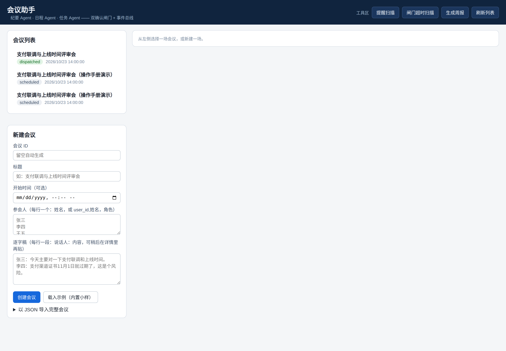
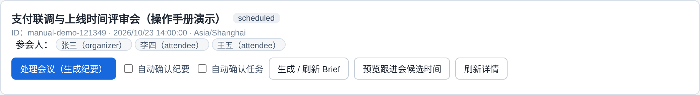
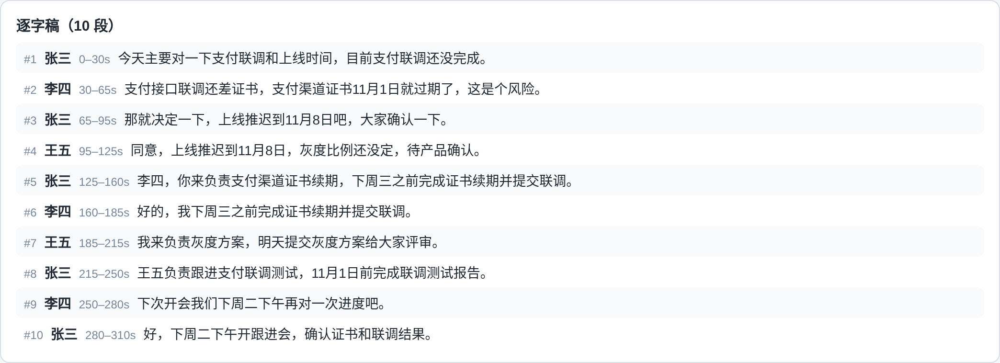
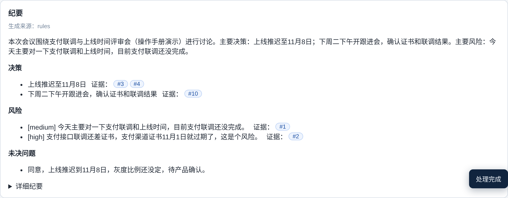
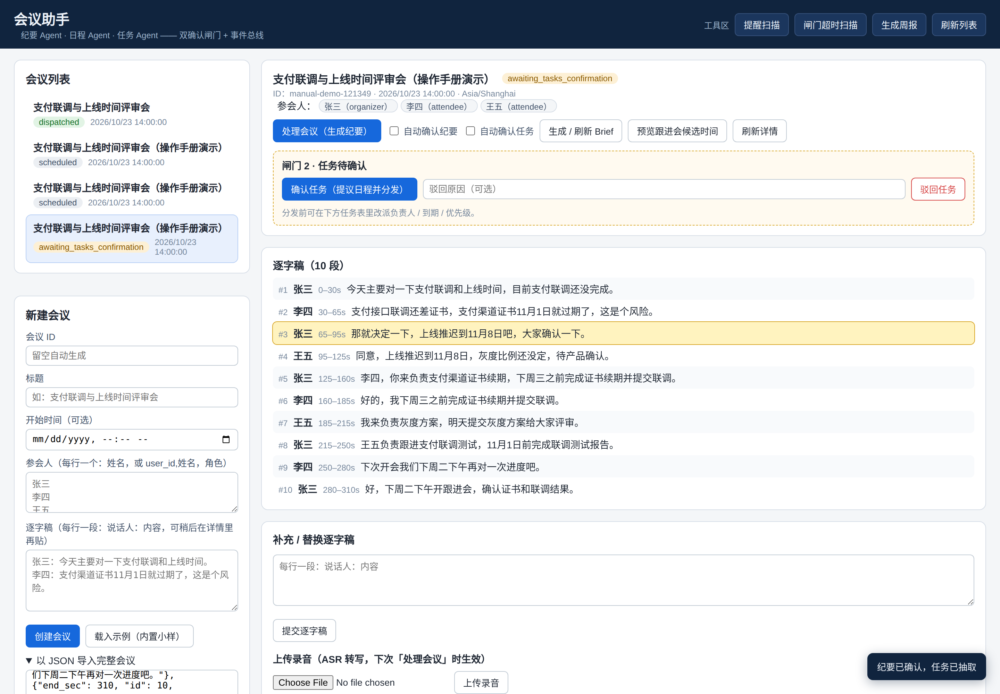
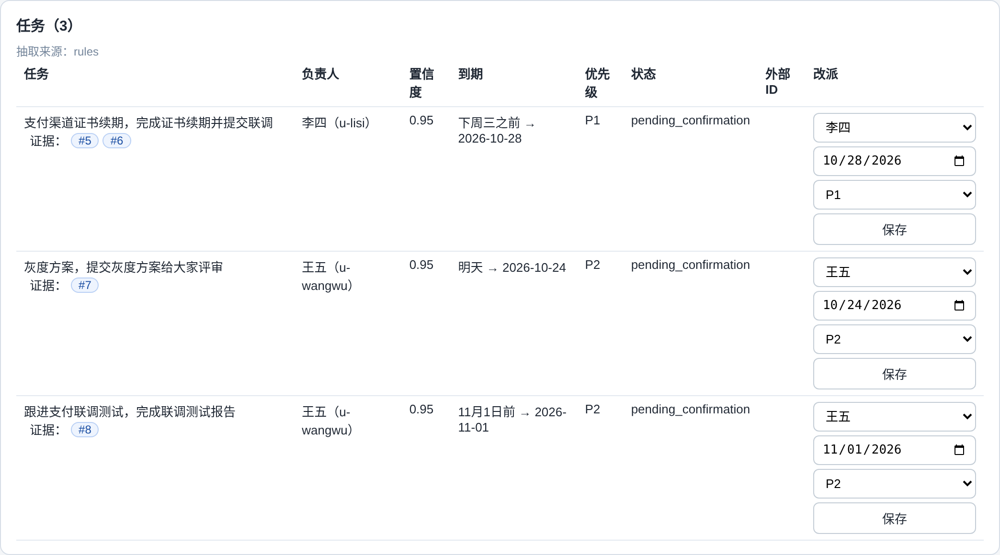
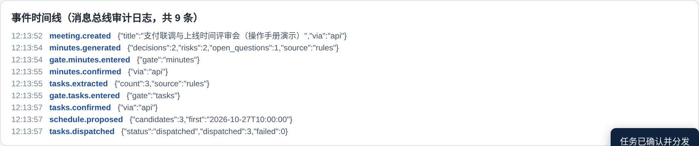
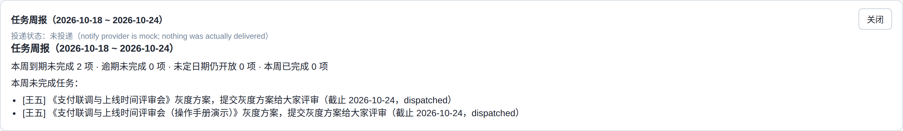

# 会议助手 · 操作手册

> 适用版本：当前线上部署版（Vercel + Neon Postgres）
> 在线地址：https://meeting-agent-swart.vercel.app/
> 本手册截图取自与线上部署同一版本的真实界面，按一场演示会议的完整流程依次截取。

---

## 一、系统简介

会议助手是一套「1 个编排器 + 3 个业务 Agent」的多智能体协同系统，帮你把一场会议从逐字稿一路推进到任务落地：

| 角色 | 职责 |
|---|---|
| **纪要 Agent** | 从逐字稿生成结构化纪要（执行摘要、决策、风险、未决问题、详细纪要），每条决策/风险都回链到逐字稿原话段落 |
| **任务 Agent** | 从纪要与逐字稿中抽取待办任务，识别负责人、到期时间与优先级，并给出负责人置信度 |
| **日程 Agent** | 提议跟进会候选时间，在任务确认后把任务分发到外部系统（如飞书任务）并登记跟进日程 |
| **编排器** | 驱动全流程状态机，在两个关键节点设置**人工确认闸门**，并通过事件总线衔接各 Agent |

整体流程：

```
新建会议 → 处理会议（生成纪要） → → 任务抽取
→ → 提议日程 + 任务分发 → 完成
```

两道闸门是本系统的核心设计：**AI 的产出必须经人确认才进入下一步**。闸门处可以确认、驳回（留原因），任务闸门处还可以在分发前改派负责人。

---

## 二、界面总览



页面分三个区域：

- **顶部工具区**：提醒扫描、闸门超时扫描、生成周报、刷新列表（详见 4.7）。
- **左栏**：上方是**会议列表**（标题 + 状态徽章 + 开始时间，点击切换详情）；下方是**新建会议**表单。
- **右栏**：选中会议的**详情区**，所有处理动作都在这里完成。

状态徽章是英文状态码（如 `scheduled`、`awaiting_minutes_confirmation`、`dispatched`），完整对照见第五节。

---

## 三、快速上手（走通一遍全流程）

1. 点新建会议区的 **「载入示例（内置小样）」**，系统会创建一场内置的演示会议并自动打开详情。
2. 在详情顶部点 **「处理会议（生成纪要）」**——稍等片刻，纪要生成，页面出现 **闸门 1**。
3. 检查纪要无误后点 **「确认纪要（进入任务抽取）」**——系统随即抽取任务，出现 **闸门 2** 和任务表。
4. 在任务表核对负责人/到期日（可改派），点 **「确认任务（提议日程并分发）」**。
5. 状态变为 `dispatched`，详情底部出现**跟进会候选时间**与**事件时间线**，全流程结束。

---

## 四、功能详解

### 4.1 新建会议（三种方式）

**方式一：表单新建**（左栏）
- 会议 ID：可留空自动生成；自填时只能用字母、数字、`.`、`-`、`_`。
- 参会人：每行一人，格式 `姓名` 或 `user_id,姓名，角色`（逗号中英文均可）。
- 逐字稿：每行一段，格式 `说话人：内容`（冒号中英文均可）；也可以先不填，建完后在详情里补充或上传录音。

**方式二：载入示例**——一键创建内置演示会议，适合第一次体验。

**方式三：JSON 导入**——展开表单底部「以 JSON 导入完整会议」，粘贴符合 Meeting 结构（如仓库 `examples/sample_meeting.json`）的 JSON 后点「导入 JSON 会议」。

创建成功后详情头部如下，可看到会议 ID、时间、时区与参会人：



### 4.2 逐字稿管理

详情中部是逐字稿区，每段带段号、说话人与时间范围：



- **补充 / 替换逐字稿**：在下方文本框粘贴（每行一段：`说话人：内容`），点「提交逐字稿」即整体替换，之后重新点「处理会议」即可按新稿生成。
- **上传录音**：选择录音文件（mp3/wav/m4a/flac/ogg/webm/mp4）点「上传录音」，系统在下一次「处理会议」时先做 ASR 转写再生成纪要（线上版需配置云端 ASR；未配置时该场会议会提示需要逐字稿）。

### 4.3 处理会议与辅助动作

详情头部的操作行：

- **处理会议（生成纪要）**：主流程入口。旁边的「自动确认纪要 / 自动确认任务」勾选后，对应闸门将自动放行（适合演示；正式使用建议手动确认）。若纪要曾被驳回，重新点此按钮会基于最新逐字稿重新生成。
- **生成 / 刷新 Brief**：生成一页会前简报（背景、议题要点），显示在详情中。
- **预览跟进会候选时间**：只预览日程 Agent 提议的候选时间，不改变流程状态，结果显示在顶部工具输出区。
- **刷新详情**：重新拉取该会议的最新状态。

### 4.4 闸门 1：纪要确认

处理完成后出现闸门 1：


- **确认纪要**：放行并触发任务抽取（经事件总线衔接，不是直接调用）。
- **驳回纪要**：可填写原因；驳回记录会留档显示在详情中，修改逐字稿后重新处理即可。

纪要本体这样看：



- 顶部标注**生成来源**（`rules` = 规则模式，`llm` = 大模型模式，后者还会标注模型名）。
- **决策 / 风险**逐条列出，风险带严重度（如 `[high]`）。
- 每条后面的 **「证据：#段号」** 是证据回链——点击段号按钮，页面会滚动到逐字稿对应段落并高亮，方便逐条核对 AI 有没有编造：



- 「详细纪要」可展开查看完整 markdown 纪要。

### 4.5 闸门 2：任务确认与改派

纪要确认后，任务 Agent 抽取的任务以表格呈现：



字段说明：

| 列 | 说明 |
|---|---|
| 任务 | 任务标题，同样带证据段号回链 |
| 负责人 | 原话中的称呼 + 消解后的 user_id（如 `李四（u-lisi）`） |
| 置信度 | 负责人消解的把握程度：精确姓名匹配 0.95、别名 0.85、模块推断 0.75、无法识别 0.3（转人工核对） |
| 到期 | 原话表述（如「下周三之前」）及解析出的具体日期 |
| 优先级 | P0 / P1 / P2 |
| 状态 | `pending_confirmation` 为待确认 |
| 外部 ID | 分发成功后回填外部系统中的任务 ID（未分发时为空） |

确认前可以在每行右侧**改派**：换负责人、改到期日期、调优先级，点「保存」即生效。


- **确认任务**：放行后日程 Agent 提议跟进会时间，任务被分发到外部系统（配置了飞书时落入飞书任务，未配置时为本地模拟分发）。
- **驳回任务**：可填原因；驳回后出现「重新抽取任务」按钮，可在不重跑纪要的情况下单独重抽任务。

### 4.6 分发结果与事件时间线

流程走完后，详情底部有两块结果：

- **跟进会候选时间**：日程 Agent 提议的下一次跟进会时间点。
- **事件时间线**：全流程在消息总线上的审计日志（会议创建、纪要生成、两次闸门确认、分发等事件依次留痕，带时间与载荷），任何一步出了问题都能在这里定位：



### 4.7 工具区（顶部）



- **提醒扫描**：扫描已分发任务的到期提醒（临近/逾期），结果显示在工具输出区。
- **闸门超时扫描**：找出在闸门处停留超过阈值（默认 48 小时）的会议并升级提醒或按配置驳回。**红线：超时永远不会自动确认**，只提醒或留痕驳回。
- **生成周报**：汇总最近 7 天的任务情况（完成/逾期/待确认等分组）生成任务周报（如上图）。
- **刷新列表**：重新加载会议列表。

> 部署在无服务器环境（如 Vercel）时没有常驻定时进程，扫描与周报以手动点击触发为准；自托管部署可开启内置定时调度。

---

## 五、会议状态说明

| 状态 | 含义 | 下一步操作 |
|---|---|---|
| `scheduled` | 已创建，未处理 | 点「处理会议」 |
| `processing` | 正在生成纪要 | 等待刷新 |
| `needs_transcript` | 缺逐字稿，无法处理 | 补充逐字稿或上传录音 |
| `minutes_draft` | 纪要草稿（内部态） | — |
| `awaiting_minutes_confirmation` | **闸门 1**：纪要待确认 | 确认或驳回纪要 |
| `minutes_rejected` | 纪要被驳回 | 改稿后重新「处理会议」 |
| `minutes_confirmed` | 纪要已确认（任务步骤被配置关闭时止于此） | — |
| `awaiting_tasks_confirmation` | **闸门 2**：任务待确认 | 核对/改派后确认或驳回 |
| `tasks_rejected` | 任务被驳回 | 点「重新抽取任务」 |
| `tasks_confirmed` | 任务已确认，待分发 | — |
| `dispatched` | 已分发完成 | 查看事件时间线与外部 ID |
| `dispatched_with_failures` | 部分任务分发失败 | 在事件时间线/外部 ID 列查看失败原因 |
| `dispatch_failed` | 分发整体失败 | 检查外部系统配置后重试 |

任务状态：`pending_confirmation`（待确认）→ `confirmed`（已确认）→ 外部系统中的实际状态。

---

## 六、数据与运行模式说明

- **数据持久化**：线上版已接入 Neon Postgres（新加坡区域），会议数据落库保存，刷新、重启、隔天访问都不会丢失。
- **生成模式**：纪要/任务卡片上标注的「生成来源」决定当前模式——
- `rules`：规则模式，不依赖任何外部模型，开箱即用；
- `llm`：大模型模式（需在部署环境配置模型 API 密钥），纪要与任务抽取质量更高，且有自动校验与证据过滤。
- **外部系统**：飞书日历/任务/通知为真实 API 对接（需在部署环境配置应用凭据与成员映射）；未配置时分发为本地模拟，流程与界面完全一致。

---

## 七、常见问题

**Q：我建的会议过一会儿不见了？**
A：线上版已接数据库，不会再丢。若列表为空，先点顶部「刷新列表」；自托管且未配置 `DATABASE_URL` 时数据只在内存中，进程重启即清空。

**Q：生成来源显示 `rules`，怎么切换到大模型？**
A：在部署环境中配置模型密钥（如火山方舟 `LLM_API_KEY` 等，见仓库 README 的环境变量表）后重新部署，新处理的会议即走 LLM 模式，卡片会标注 `llm` 与模型名。

**Q：纪要里有条决策不对，怎么办？**
A：不要确认——在闸门 1 驳回并写明原因，修正逐字稿（或补充说明段落）后重新「处理会议」。驳回记录会留档，便于复盘。

**Q：任务负责人识别错了？**
A：置信度低（如 0.3）的任务本来就建议人工核对。在闸门 2 的任务表里直接用「改派」列修正负责人/到期/优先级再确认；整批都不对可驳回任务后「重新抽取任务」。

**Q：点「处理会议」提示需要逐字稿？**
A：该会议没有逐字稿且录音转写不可用。在详情里粘贴逐字稿，或上传录音后再处理。

**Q：第一次打开页面很慢？**
A：无服务器部署存在冷启动（数秒至数十秒），属正常现象；热起来后每步约几秒（包含数据库往返）。

**Q：闸门一直没人确认会怎样？**
A：什么都不会自动发生——系统绝不自动确认。可用「闸门超时扫描」发出升级提醒，或按配置在超时后留痕驳回。

---

## 附：演示会议情节（内置示例）

示例会议《支付联调与上线时间评审会》：张三（产品经理）、李四（支付后端）、王五（测试）三人评审——支付渠道证书 11 月 1 日过期（风险）、上线推迟至 11 月 8 日（决策）、李四负责证书续期（下周三前）、王五负责灰度方案与联调报告、下周二下午开跟进会。用它走一遍全流程，即可对照本手册逐项验证每个功能。
